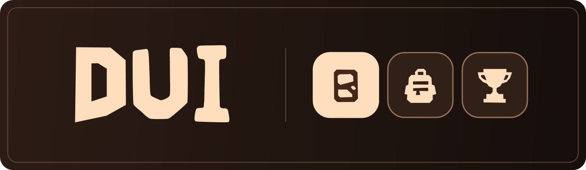

<h1 align="center"></h1>

<p align="center">DOORS 风格的 React 组件库</p>
<p align="center">
  <a href="https://doors-chinese-wiki.github.io/DUI/">组件文档</a> ·
  <a href="https://doors-chinese-wiki.github.io/DUI/#lobby">大厅示例</a> ·
  <a href="docs/MEDIAWIKI.md">MediaWiki 安装</a> ·
  <a href="https://doors-chinese-wiki.github.io/DUI/downloads/dui-mediawiki-0.1.2.zip">下载组件包</a>
</p>

## 在 React 中使用

使用 Node.js 24，在仓库目录运行以下命令。

```sh
npm ci
npm run dev
```

打开终端显示的地址。在 `src/App.tsx` 中导入按钮和图标。

```tsx
import { Button, Icon } from './components';

export default function App() {
  return (
    <Button leadingIcon={<Icon name="items" size={20} />}>
      打开物品栏
    </Button>
  );
}
```

项目入口 `src/main.tsx` 加载主题和字体。将组件复制到其他 React 项目时，保留组件的 CSS 模块，并在入口加载 `src/styles/global.css`。

## 接入 MediaWiki

管理员加载 `dui.js` 和 `dui.css` 后，在词条中用 `data-dui` 指定组件，用 `data-dui-props` 填写 JSON。

```html
<div class="dui-widget" data-dui="inventory"
     data-dui-props='{"items":[{"id":"lighter","icon":"lighter","file":"File:Icon lighter2.png"}]}'>
  物品栏：打火机
</div>
```

`file` 指定 Wiki 文件，`icon` 提供后备图。完整配置见 [MediaWiki 安装说明](docs/MEDIAWIKI.md)。

## 开发

组件代码在 `src/components`。文档的预览和代码标签共用 `src/docs/examples` 中的文件。新增示例时，在 `src/docs/examples/registry.ts` 注册。

| 命令 | 用途 |
| --- | --- |
| `npm run storybook` | 在 Storybook 中查看组件 |
| `npm run check` | 运行单元测试，构建文档和 Storybook |
| `npm run test:e2e` | 运行文档浏览器测试。截图基线使用 Windows Chrome |
| `npm run test:mediawiki` | 构建并测试 MediaWiki 组件包 |
| `npm run pack:mediawiki` | 生成 ZIP 和 TGZ，存入 `artifacts/` |
| `npm run build:pages` | 将文档与组件包构建到 `dist/` |

首次运行浏览器测试前，执行 `npx playwright install chrome`。推送到 `main` 后，GitHub Actions 构建并部署文档。详见 [Pages 部署说明](docs/PAGES.md)。

## 素材

封面使用 DOORS 字体中的门、背包和奖杯字形。DOORS 美术和标识归原作者所有。发行包附带依赖许可证，项目代码尚未指定开源许可证。[素材来源](ATTRIBUTION.md)
